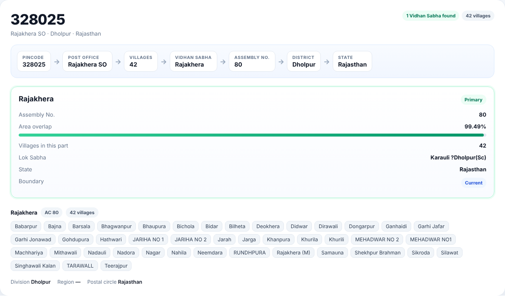

# India Pincode → Vidhan Sabha

Map every Indian PIN code and village to its Assembly Constituency (Vidhan Sabha), using official boundary data.

**Pincode → Post Office / Village → Vidhan Sabha → Assembly No. → District → State**

| | |
|---|---|
| PIN codes | 19,312 |
| Villages | 5.84 lakh |
| Vidhan Sabhas | 4,100+ |
| States / UTs | 36 |


## Live site

`index.html` in this repository is the ready-to-host lookup page. Its data is encrypted and compressed, CSV export is turned off, and automated scrapers are blocked. To publish it free with GitHub Pages, go to **Settings → Pages**, choose **Deploy from a branch**, and select the `main` branch and the `/ (root)` folder. The site will be live at `https://<your-username>.github.io/<repo-name>/` within a minute or two.

## What it does

A single Python script reads KML boundary files and produces:

- **An offline lookup page.** Search a 6-digit PIN code to see its post office, the villages inside it and every Vidhan Sabha it overlaps, ranked by share of area, with the Assembly No., Lok Sabha seat, district and state. You can also search by village name, browse and filter all PIN codes, and export results to CSV (the CSV button is only in the page you build locally, not in the hosted `index.html`).
- **An Excel workbook** with the pincode hierarchy, every PIN–constituency overlap and a summary for each Vidhan Sabha.
- **A village-level CSV**, with one row per village giving its pincode, post office, Vidhan Sabha and AC number.
- **A terminal lookup** for quick searches.



## Quick start

```bash
pip install -r requirements.txt
python india_pincode_vidhan_sabha.py build --input-dir kml --out output
```

Then open `output/India_Pincode_Vidhan_Sabha.html` in any browser, or search from the terminal:

```bash
python india_pincode_vidhan_sabha.py lookup 328025
python india_pincode_vidhan_sabha.py lookup Daulatpur
python india_pincode_vidhan_sabha.py lookup 328025 --villages   # also list village names
```

The full all-India build takes about 5–10 minutes and needs around 8 GB of RAM. If memory is tight, add `--workers 1`.

## Input data

The KML files are too large for GitHub, so they are not included in this repository. Download them and place them in a `kml/` folder:

| File | Contents |
|---|---|
| `lgd_villages*.kml` (one or more files) | LGD village boundaries with state, district, sub-district, block, gram panchayat and LGD codes |
| `LGD_Assembly_Constituencies.kml` | Assembly constituency boundaries (AC no., AC name, PC name, district, state) |
| `Datagov_Pincode_Boundaries.kml` | Pincode boundaries from data.gov.in (pincode, office name, division, region, circle) |

With `--input-dir`, files are picked by name: any file containing *village*, *pincode* or *assembly*. You can also name them directly:

```bash
python india_pincode_vidhan_sabha.py build --villages "kml/lgd_villages*.kml" --pincodes kml/Datagov_Pincode_Boundaries.kml --acs kml/LGD_Assembly_Constituencies.kml --out output
```

## Output

| File | Description |
|---|---|
| `India_Pincode_Vidhan_Sabha.html` | Self-contained offline lookup page (about 9 MB, data built in) |
| `pincode_vidhan_sabha.xlsx` | Sheets: **Pincode Hierarchy**, **PIN-AC Overlaps**, **Vidhan Sabha** |
| `village_hierarchy.csv` | One row per village (about 100 MB) |
| `lookup_data.json` | Data used by the page and by the `lookup` command |

These outputs contain the full raw data, so `.gitignore` keeps them (and the `kml/` folder) out of the repository.

## How the mapping works

1. **Village → Pincode / Vidhan Sabha.** Each village is represented by a point guaranteed to lie inside its boundary. That point is tested against the pincode and constituency polygons. Points that fall in small gaps between boundaries take the nearest polygon within about 2 km.
2. **Pincode → Vidhan Sabha.** Each pincode boundary is overlaid on the constituencies, and the share of its area inside each one is measured. The largest share is the **primary** Vidhan Sabha. The others are listed with their percentages.
3. **Noise filter.** Overlaps under 1% are dropped unless a village falls in that constituency. These are usually slivers where two datasets' boundaries don't line up exactly.
4. **District and State** come from the villages' own LGD records. For city PIN codes with no village inside, they come from the constituency file.

## Known limitations

- Constituencies in Arunachal Pradesh, Assam, Jammu & Kashmir, Jharkhand, Ladakh, Manipur and Nagaland are **pre-delimitation** in the source file. They are marked as such, and their AC numbers may differ from current ones.
- The constituency file lists Telangana under Andhra Pradesh. The script separates them using Telangana's 17 Lok Sabha seats.
- Some states have no village file, or only partial coverage. Their PIN codes are still mapped through area overlap.
- Boundary-based mapping is approximate near edges. Check critical cases against official electoral rolls.

## Requirements

Python 3.9+ and the packages in `requirements.txt` (`numpy`, `lxml`, `shapely`, `pandas`, `openpyxl`). Works on Windows, macOS and Linux.

## Data sources

- Local Government Directory (LGD), Government of India: village and assembly constituency boundaries
- Open Government Data Platform India ([data.gov.in](https://data.gov.in)): pincode boundaries

Government data is used under the [Government Open Data License – India](https://data.gov.in/government-open-data-license-india).
